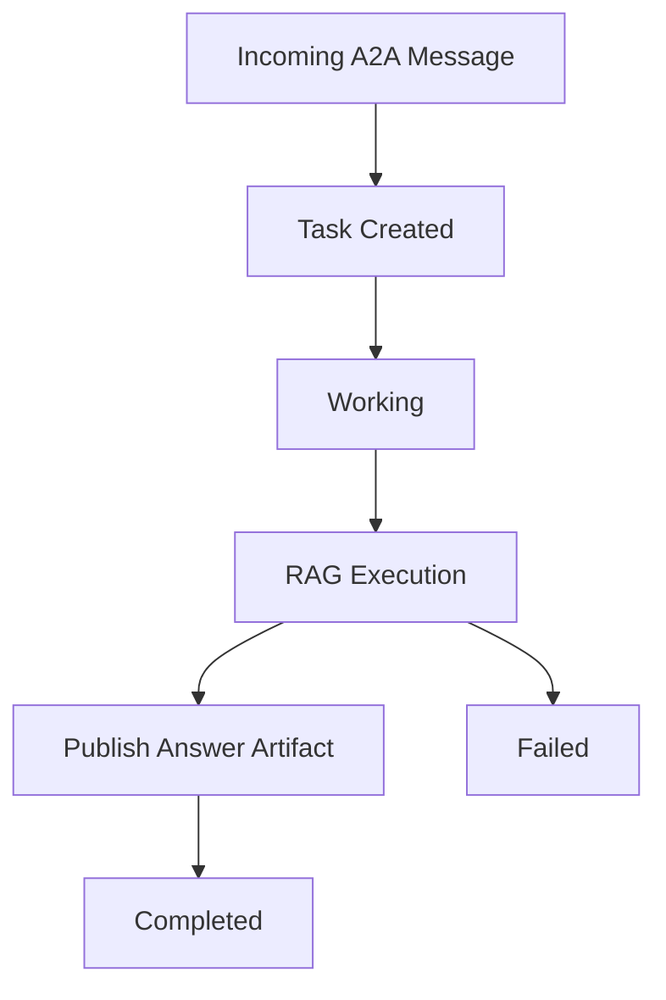
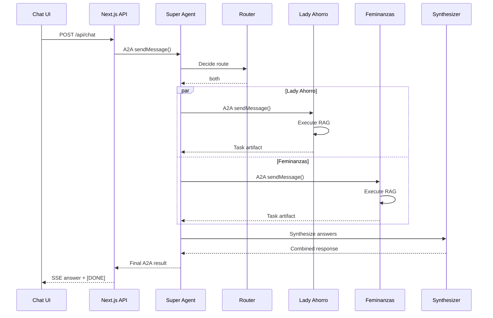

# A2A Communication

## Overview

This project uses the **Agent2Agent (A2A) protocol** to enable communication between independently running AI agents.

A2A provides a standardized way for agents to discover capabilities, exchange messages, execute tasks, and return results without requiring knowledge of each other's internal implementation.

The implementation uses the official JavaScript SDK:

```bash
@a2a-js/sdk
```

The architecture consists of three independent A2A servers:

| Agent | Endpoint | Role |
|---|---|---|
| Lady Ahorro | `http://localhost:3001` | Personal finance specialist |
| Super Agent | `http://localhost:3002` | Agent orchestrator |
| Feminanzas | `http://localhost:3003` | Women's financial education specialist |

Each agent exposes an A2A interface and implements its own execution logic.

---

## 1. Agent Architecture

Each agent follows a similar internal structure:

Agents live under `pages/lady-agent/`, `pages/femi-agent/`, and `pages/super-agent/`:

```text
pages/<agent>/
├── card.ts
├── executor.ts
├── request-handler.ts
└── server.ts
```

The Super Agent also includes `router.ts` and `synthesizer.ts`. Shared helpers live in `lib/agents/` (`config.ts`, `createAgentServer.ts`, `message.ts`).

| File | Responsibility |
|---|---|
| `card.ts` | Defines the agent's identity and capabilities |
| `executor.ts` | Implements the agent's execution logic |
| `request-handler.ts` | Connects incoming A2A requests to the executor |
| `server.ts` | Starts the HTTP server and exposes the A2A interface |

This separation keeps protocol handling independent from the agent's actual business logic.

## 2. Agent Cards

An Agent Card describes an agent and the capabilities it exposes.

Each server makes its Agent Card available through the well-known endpoint:

```text
/.well-known/agent-card.json
```

The Agent Card provides information that allows an A2A client to understand what an agent does and how it can communicate with it.

Conceptually, an Agent Card describes:

- Agent name and description.
- Supported communication URL.
- Supported protocol version.
- Available skills.
- Supported input and output modes.

In this project, each agent has its own Agent Card.

The Super Agent currently uses a static specialist configuration keyed off `agentUrls` from `lib/agents/config.ts` (defaults: Lady Ahorro on `3001`, Feminanzas on `3003`):

```ts
const specialists = {
  lady: {
    name: "Lady Ahorro",
    url: agentUrls.lady,
  },
  femi: {
    name: "Feminanzas",
    url: agentUrls.femi,
  },
};
```

The `ClientFactory` connects to these configured endpoints.

Although the Agent Cards are exposed, the current Super Agent does not dynamically discover specialists from them. Dynamic discovery could be introduced in a future iteration.

## 3. Request Handler

The request handler connects the A2A protocol implementation to the agent executor.

The project uses the SDK's:

- `DefaultRequestHandler`
- `InMemoryTaskStore`

The request handler is responsible for processing incoming A2A requests, managing task execution, and delegating the actual work to the appropriate executor.

The `InMemoryTaskStore` provides task storage during the server process lifetime.

This means task state is not persisted across server restarts.

The important architectural distinction is:

**The request handler manages protocol-level execution; the executor implements what the agent actually does.**

## 4. Agent Executor

The executor contains the agent's application logic.

For example, the Lady Ahorro executor performs the following workflow:

1. Receives an incoming A2A message.
2. Extracts the user's question from the message parts.
3. Publishes a working task status.
4. Loads the Lady Ahorro vector store.
5. Creates and executes the specialist's RAG pipeline.
6. Publishes the generated answer as an artifact.
7. Publishes the completed task status.

Feminanzas follows the same execution pattern but uses its own vector store and RAG implementation.

This is what makes the specialists independent: they share a communication protocol, not their internal knowledge or execution logic.

## 5. Sending A2A Messages

The Super Agent uses the SDK's `ClientFactory` to create clients for specialist agents.

### Creating a client

```ts
import { ClientFactory } from "@a2a-js/sdk/client";

const factory = new ClientFactory();

const client = await factory.createFromUrl(
  specialist.url,
);
```

The client is created using the specialist's endpoint.

This avoids implementing the underlying HTTP communication manually.

### Sending a message

The SDK's `sendMessage()` method sends an A2A message to the selected agent.

The request follows the A2A message structure:

```ts
import { Role } from "@a2a-js/sdk";

const result = await client.sendMessage({
  message: {
    messageId: crypto.randomUUID(),
    contextId: crypto.randomUUID(),
    taskId: "",
    role: Role.ROLE_USER,
    parts: [
      {
        content: {
          $case: "text",
          value: question,
        },
        metadata: undefined,
        filename: "",
        mediaType: "text/plain",
      },
    ],
    metadata: undefined,
    extensions: [],
    referenceTaskIds: [],
  },
  tenant: "",
  configuration: undefined,
  metadata: undefined,
});
```

### Understanding the message structure

| Field | Purpose |
|---|---|
| `messageId` | Unique identifier for the message |
| `contextId` | Identifies the conversation context |
| `taskId` | Identifies an existing task when applicable |
| `role` | Identifies the message sender |
| `parts` | Contains the message content |
| `metadata` | Optional additional message information |
| `extensions` | Extension information supported by the protocol |
| `referenceTaskIds` | References related tasks |

The message content is represented as a text part.

The `$case` property identifies which content variant is being used. In this implementation, it is `"text"`.

The request also includes SDK-level configuration fields such as `tenant`, `configuration`, and `metadata`.

### Message, Context, and Task

These identifiers represent different concepts:

- **Message:** An individual communication between agents.
- **Context:** Groups messages associated with a conversation.
- **Task:** Represents work performed by an agent in response to a request.

They should not be treated as interchangeable identifiers.

The current implementation generates new message and context IDs for each specialist request. Persistent conversation context and task continuation are not yet implemented.

---

## 6. Task Lifecycle

One of the most important concepts in A2A is that a response can represent the execution of a task rather than simply returning a string.

The specialist executors publish task updates as they work.

The current implementation follows this general lifecycle:



The task lifecycle communicates the execution state to the client.

The project uses task states such as:

- `TASK_STATE_WORKING`
- `TASK_STATE_COMPLETED`
- `TASK_STATE_FAILED`

The executor publishes status updates through the A2A execution context.

This allows the agent to communicate progress and completion independently of the actual answer content.

## 7. Artifacts and Responses

The generated answer is returned as an A2A artifact.

An artifact represents output produced by an agent during task execution.

In our implementation, the specialist publishes a text artifact containing its RAG response.

For example, the Lady Ahorro executor publishes an artifact named:

```text
Lady Ahorro answer
```

The Feminanzas executor publishes:

```text
Feminanzas answer
```

The Super Agent does not need to know how the answer was generated. It only needs to extract the text from the returned artifact.

```ts
const answer =
  "artifacts" in result
    ? (result.artifacts ?? [])
        .flatMap((artifact) => artifact.parts)
        .filter(
          (part) => part.content?.$case === "text",
        )
        .map((part) => part.content?.value)
        .join("\n")
    : "";
```

The result is then available to the Super Agent for further processing.

### Handling failures

The Super Agent checks whether a specialist task failed:

```ts
if (
  "status" in result &&
  result.status?.state === TaskState.TASK_STATE_FAILED
) {
  throw new Error("Specialist task failed.");
}
```

It also validates that the response contains a text artifact.

This prevents the orchestration layer from silently accepting an empty specialist response.

---

## 8. Super Agent Orchestration

The Super Agent is itself an A2A agent.

It exposes its own Agent Card, request handler, executor, and server.

However, its executor has a different responsibility: it acts as an orchestrator of other agents.

The orchestration process has three main stages:

1. Routing.
2. Specialist execution.
3. Response synthesis.

### 8.1 Routing

The router uses an LLM with structured output to select the appropriate specialist agents.

The routing schema is defined with Zod:

```ts
const routingSchema = z.object({
  route: z.enum([
    "lady",
    "femi",
    "both",
  ]),
});
```

The router returns one of three possible routes:

| Route | Selected specialist |
|---|---|
| `lady` | Lady Ahorro |
| `femi` | Feminanzas |
| `both` | Both specialists |

The router is responsible only for selecting agents. It does not execute their RAG pipelines.

### 8.2 Specialist Execution

After routing, the Super Agent resolves the selected specialists and calls them through A2A.

The `askSpecialist()` function encapsulates the communication process:

```ts
const askSpecialist = async (
  specialist: Specialist,
  question: string,
) => {
  const factory = new ClientFactory();
  const client = await factory.createFromUrl(
    specialist.url,
  );

  const result = await client.sendMessage(
    buildUserSendMessageRequest(question),
  );

  // Validate task state and extract artifact text.

  return {
    name: specialist.name,
    answer,
  };
};
```

The important point is that the Super Agent does not import `makeRag()`, `getVectorStore()`, or any specialist-specific implementation.

It communicates exclusively through the A2A client.

### 8.3 Parallel Execution

When both specialists are selected, the Super Agent calls them concurrently using `Promise.all()`.

```ts
const answers = await Promise.all(
  selectedSpecialists.map((specialist) =>
    askSpecialist(specialist, question),
  ),
);
```

This means:

- Both agents receive independent A2A messages.
- Both execute their own tasks.
- Neither agent needs to know about the other.
- The Super Agent waits for both responses before continuing.

This is a key advantage of the architecture: multiple independent agents can collaborate without being tightly coupled.

### 8.4 Response Synthesis

After receiving the specialist responses, the Super Agent decides whether synthesis is necessary.

```ts
const answer =
  answers.length > 1
    ? await synthesizeAnswers(question, answers)
    : answers[0].answer;
```

If only one specialist was selected, its answer is returned directly.

If both specialists were selected, the synthesizer receives the original question and both answers.

The synthesizer is responsible for producing a coherent response while preserving the information and source URLs provided by the specialists.

Finally, the Super Agent publishes its own answer as an artifact and marks its task as completed.

This means the Super Agent participates in A2A communication just like the specialists, but its internal execution logic is focused on orchestration.

---

## 9. Complete A2A Communication Flow

Putting everything together:



The diagram illustrates the complete flow for a question routed to both specialists.

When only one specialist is selected, the other branch and the synthesis step are skipped.

---

## 10. Testing A2A Communication

There is no checked-in `test-client.ts` today. You can still exercise agents independently of the React frontend by using `@a2a-js/sdk` the same way the Super Agent and `/api/chat` do:

1. Create an A2A client with `ClientFactory`.
2. Connect to an agent URL from `lib/agents/config.ts`.
3. Build a user message (see `buildUserSendMessageRequest` in `lib/agents/message.ts`).
4. Send the request with `sendMessage()`.
5. Inspect the returned task status and artifacts.

Useful test scenarios include:

- Sending a question directly to Lady Ahorro.
- Sending a question directly to Feminanzas.
- Asking the Super Agent a question routed to one specialist.
- Asking the Super Agent a question routed to both specialists.
- Inspecting task status and returned artifacts.

---

## 11. Current Implementation and Future Improvements

The current implementation demonstrates the fundamentals of A2A communication and multi-agent orchestration.

### Implemented

- Independent A2A servers.
- Agent Cards exposed through well-known endpoints.
- Request handlers and executors.
- A2A client creation using `ClientFactory`.
- Message-based communication using `sendMessage()`.
- Task status updates.
- Artifact-based responses.
- Specialist routing.
- Parallel execution of multiple agents.
- Multi-agent response synthesis.

### Potential improvements

- Dynamic agent discovery using Agent Cards.
- Persistent task storage instead of `InMemoryTaskStore`.
- Persistent conversation contexts.
- A2A streaming communication.
- Partial-success handling when one specialist fails.
- Authentication between agents.
- Improved tracing and observability.

## Conclusion

A2A provides the communication foundation that allows this project to move beyond a single-agent architecture.

Each specialist is an independent service with its own capabilities and internal implementation. The Super Agent communicates with these services through standardized A2A messages, coordinates their tasks, and combines their results.

The key architectural idea is that **agents collaborate through a shared communication protocol without needing to share their internal implementation.**