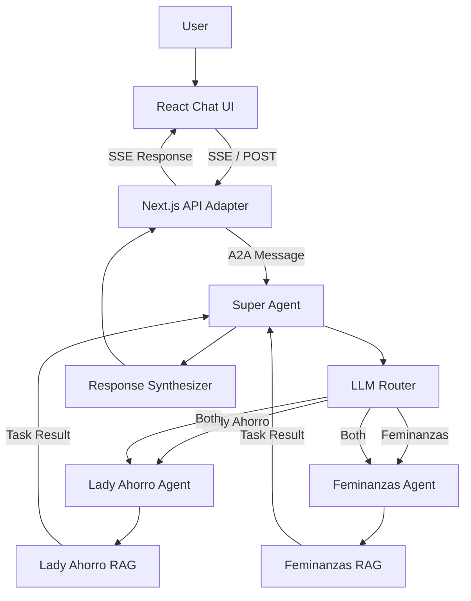

# Architecture

## Overview

The Multi-Agent Financial Assistant is built around a distributed agent architecture.

Instead of relying on a single AI agent to handle every financial topic, the system delegates responsibilities to specialized agents. Each specialist operates independently, maintains its own knowledge base, and exposes its capabilities through the Agent2Agent (A2A) protocol.

A central Super Agent coordinates the workflow, determines which specialists should handle a question, and combines their responses when necessary.

## System Components

### 1. Frontend

The frontend is a React-based chat interface built with Next.js.

It is responsible for:
- Collecting user questions.
- Displaying conversation messages.
- Rendering responses.
- Handling the existing Server-Sent Events (SSE) communication.

The frontend does not communicate directly with individual specialist agents.

### 2. Next.js API Adapter

The `/api/chat` endpoint acts as a communication bridge between the frontend and the Super Agent.

It preserves the frontend's existing SSE interface while using the A2A JavaScript SDK to communicate with the Super Agent.

Its responsibilities are:
- Receiving user questions.
- Sending A2A messages to the Super Agent.
- Extracting the final answer from the returned task artifacts.
- Forwarding the answer to the frontend through SSE.

This allows the multi-agent backend to evolve without requiring a complete rewrite of the existing chat interface.

### 3. Super Agent

The Super Agent is responsible for coordinating the multi-agent workflow.

It does not own the specialists' domain knowledge. Instead, it delegates questions to the appropriate agents.

Its main responsibilities are:

- **Routing:** determining which specialists should handle a question.
- **Orchestration:** communicating with selected specialists through A2A.
- **Parallel execution:** contacting multiple specialists concurrently when required.
- **Synthesis:** combining specialist responses into one coherent answer.

### 4. Specialist Agents

The system currently includes two independent specialists.

**Lady Ahorro**

Focused on personal finance, saving, budgeting, and intelligent investing.

**Feminanzas**

Focused on women's financial education and financial independence.

Each specialist has its own:
- A2A server.
- Agent Card.
- Request handler.
- Executor.
- RAG pipeline.
- Knowledge base.

This separation allows specialists to evolve independently.

## Communication Flow

The following diagram illustrates the complete request lifecycle.

### Request Lifecycle

1. The user submits a question through the React chat interface.
2. The frontend sends the question to `/api/chat`.
3. The Next.js API adapter creates an A2A client and sends the question to the Super Agent.
4. The Super Agent uses its router to select the appropriate specialist agents.
5. Selected specialists receive independent A2A messages and execute their own RAG pipelines.
6. Each specialist returns its result through an A2A task artifact.
7. The Super Agent collects the responses.
8. If multiple specialists were selected, the synthesizer combines their answers.
9. The Super Agent returns the final result.
10. The Next.js API adapter forwards the answer to the frontend through SSE.

## Agent Endpoints

Each agent runs as an independent local server.

| Agent | Endpoint | Responsibility |
|---|---|---|
| Lady Ahorro | `http://localhost:3001` | Personal finance specialist |
| Super Agent | `http://localhost:3002` | Routing and orchestration |
| Feminanzas | `http://localhost:3003` | Women's financial education specialist |

## Architectural Principles

### Separation of Responsibilities

Each component has a clearly defined responsibility.

- The frontend handles user interaction.
- The API adapter bridges communication protocols.
- The Super Agent handles orchestration.
- Specialist agents handle domain-specific knowledge.
- RAG pipelines handle knowledge retrieval and answer generation.

### Independent Agents

Specialists operate as independent A2A servers.

The Super Agent communicates with them through the A2A protocol rather than importing their internal implementation or calling their RAG functions directly.

### Extensibility

New specialists can be introduced without fundamentally changing the existing architecture.

A new agent would need its own domain-specific implementation and A2A interface. The Super Agent could then be extended to route relevant questions to it.

### Protocol-Based Communication

A2A provides a standardized communication layer between agents.

This separates the communication contract from the internal technology used by each agent.

## Current Limitations

The current implementation is a working foundation rather than a production-ready distributed system.

Some limitations include:

- Specialist endpoints are configured statically.
- Agent communication currently uses `sendMessage()` rather than streaming A2A responses.
- Conversation context is not yet managed as a persistent shared context across requests.
- Parallel specialist execution currently uses `Promise.all()`, so a specialist failure can fail the combined operation.
- Vector stores use in-memory `MemoryVectorStore` and are rebuilt lazily on first use after a process restart (download HTML first with `yarn download-lady` / `yarn download-femi`).

These are potential areas for future development.