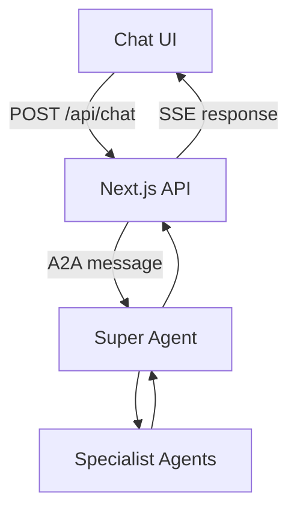

# Frontend Integration

## Overview

The frontend is a simple chat interface built with React and Next.js. It provides the user interface for interacting with the multi-agent system.

Rather than communicating directly with the specialist agents, the frontend sends messages to a Next.js API endpoint, which acts as an adapter between the chat UI and the Super Agent.

## Communication Flow

## Chat Interface

The chat component is responsible for:

- Displaying the conversation.
- Capturing user questions.
- Sending messages to the backend.
- Displaying the responses.
- Showing a pending state while waiting for an answer.

The UI uses `@microsoft/fetch-event-source` to communicate with the API through Server-Sent Events (SSE).

## API Adapter

The `/api/chat` endpoint bridges the frontend and the Super Agent.

Its responsibilities are:

1. Receive the user's question from the chat interface.
2. Create an A2A message.
3. Send the message to the Super Agent using `@a2a-js/sdk`.
4. Extract the final text response from the returned A2A artifacts.
5. Forward the answer to the frontend using SSE.

This keeps the frontend independent of the internal multi-agent architecture.

## Response Handling

The frontend continues to use its existing SSE contract:

- Responses are sent as SSE `data` events.
- The response content is wrapped in a JSON object containing a `data` field.
- A `[DONE]` event signals that the response is complete.

**Current limitation:** Although the frontend uses SSE, the Super Agent communication currently uses `sendMessage()`, which returns the completed response. Therefore, the answer is forwarded as a single chunk rather than streamed token by token.

## Current Limitations

- The chat UI sends `{ question, history }` to `/api/chat`, but the handler only reads `question` — history is not forwarded to the Super Agent.
- Each API request creates a new A2A context ID, so conversations do not yet maintain a shared A2A context across messages.
- The frontend does not communicate directly with specialist agents.

These are potential improvements rather than requirements for the initial integration.