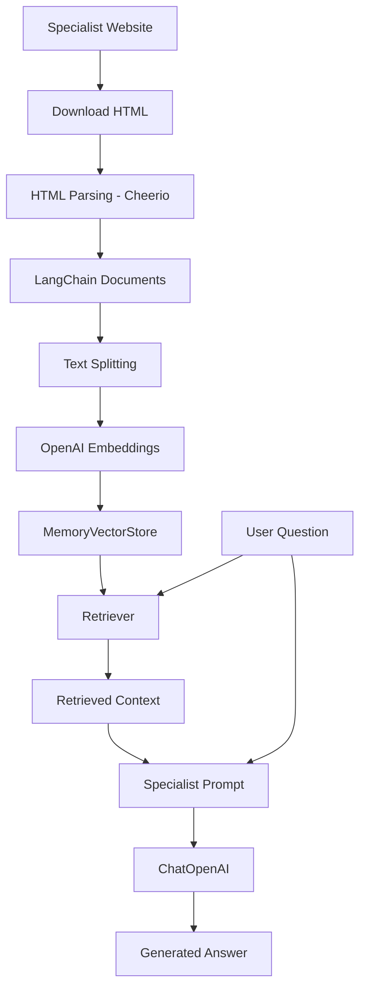
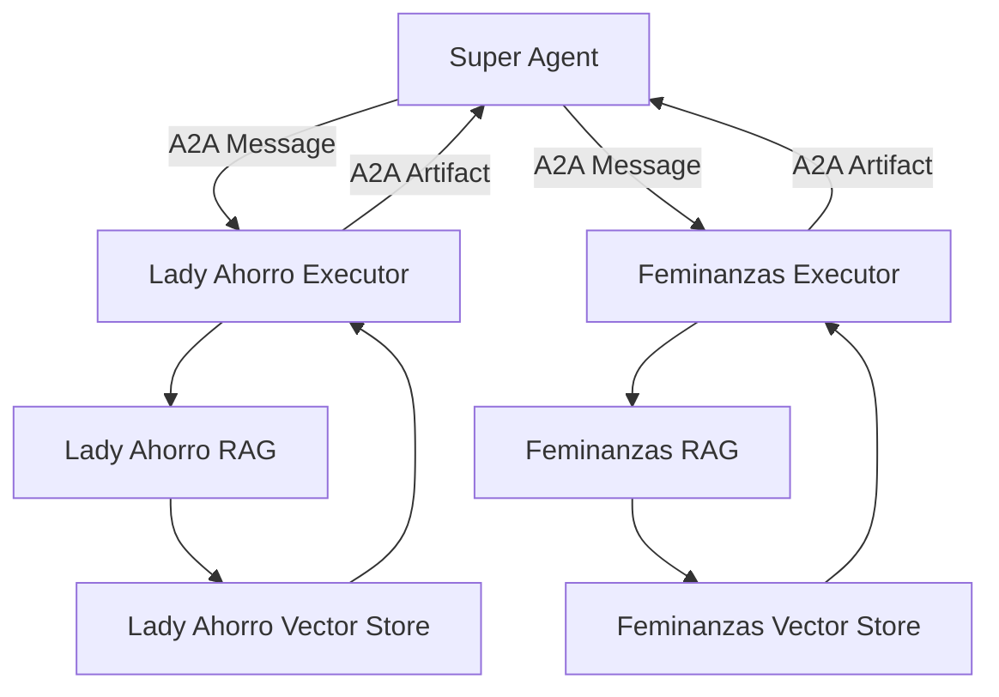

# RAG Pipelines

## Overview

Each specialist agent has its own Retrieval-Augmented Generation (RAG) pipeline and independent knowledge base.

The purpose of RAG is to ground LLM responses in relevant external content rather than relying exclusively on the model's pre-trained knowledge.

This project uses LangChain to implement the retrieval and generation workflow.

The two pipelines follow the same general architecture but operate on different websites, documents, and prompts.



## 1. Independent Knowledge Bases

Each specialist uses its own website as a source of domain-specific knowledge.

| Specialist | Knowledge source |
|---|---|
| Lady Ahorro | `https://ladyahorro.com` |
| Feminanzas | `https://feminanzasonline.com` |

The pipelines are independent. Content downloaded for one specialist is not mixed with the knowledge base of the other.

This ensures that each agent retrieves information from its own domain.

## 2. Content Download

The first stage is downloading the websites' HTML content.

The project uses separate download scripts:

```bash
yarn download-lady  # downloadLady.sh → ladyahorro.com/
yarn download-femi  # downloadFemi.sh → feminanzasonline.com/
```

These scripts use `wget` to retrieve website content locally.

The downloaded HTML files become the input for ingestion.

Keeping download separate from agent execution makes it possible to prepare or refresh the knowledge sources independently.

## 3. HTML Parsing and Document Creation

Ingestion lives in `ingest.ts` (Lady Ahorro) and `ingest-femi.ts` (Feminanzas). Both export an async `run()` that parses HTML, splits text, embeds chunks, and returns a `MemoryVectorStore`.

They are invoked by `pages/api/vectorstore.ts` when a specialist first needs its store — not by running the files as standalone CLI entry points. `yarn ingest-lady` / `yarn ingest-femi` currently load those modules and exit without calling `run()`. See [Development Guide](development.md).

The ingestion modules use **Cheerio** to parse downloaded HTML.

Cheerio provides a jQuery-like API for traversing and extracting content from HTML without requiring a browser.

The general workflow is:

1. Read downloaded HTML files.
2. Load the HTML into Cheerio.
3. Extract relevant textual content.
4. Extract relevant links.
5. Create LangChain `Document` objects.
6. Attach source metadata.

A LangChain Document contains:

- `pageContent`: the extracted textual content.
- `metadata`: additional information about the document, such as its source URL.

Keeping source metadata is important because it allows the RAG pipeline to associate retrieved content with its original webpage.

## 4. Document Splitting

Webpages can contain more information than should be passed to an LLM in a single prompt.

The ingestion modules split documents into smaller chunks using LangChain's text splitting utilities.

Current configuration:

| Setting | Value |
|---|---:|
| Chunk size | 1,000 |
| Chunk overlap | 200 |

Chunk overlap helps preserve context between consecutive chunks.

For example, information at the end of one chunk can remain available at the beginning of the next.

The resulting chunks are then used to generate embeddings.

## 5. Embeddings

The project uses OpenAI Embeddings to convert document chunks into vector representations.

Embeddings represent the semantic meaning of text numerically.

This allows the retrieval system to find documents based on semantic similarity rather than relying only on exact keyword matches.

The same embedding model configuration is used when creating the vector store and when retrieving information.

## 6. Vector Stores

The current implementation uses LangChain's `MemoryVectorStore`.

Each specialist has an independent vector store.

```text
Lady Ahorro
    └── MemoryVectorStore

Feminanzas
    └── MemoryVectorStore
```

The vector stores are initialized lazily through `pages/api/vectorstore.ts`.

Instead of creating them immediately when an agent process starts, they are built when that agent first needs them. `getVectorStore` / `getFemiVectorStore` call the corresponding `run()` export from `ingest.ts` / `ingest-femi.ts`.

The initialization promises are cached:

```ts
let vectorStorePromise:
  Promise<MemoryVectorStore> | undefined;

export const getVectorStore = () => {
  if (!vectorStorePromise) {
    vectorStorePromise = createVectorStore(); // run() from ingest.ts
  }

  return vectorStorePromise;
};
```

The Feminanzas vector store follows the same pattern with `getFemiVectorStore`.

### Why lazy initialization?

- Avoids rebuilding the vector store on every request.
- Prevents unnecessary ingestion when an agent has not received a request.
- Allows multiple requests to share the same initialization process.
- Keeps the agent executor independent of ingestion details.

### Current limitation

`MemoryVectorStore` stores vectors in application memory.

The data is not persisted between process restarts, meaning the vector store must be rebuilt when needed after restarting the agent.

A persistent vector database could replace it in a future iteration.

## 7. Retrieval

When a specialist receives a question, its RAG pipeline uses a retriever to find relevant documents.

The retriever searches the specialist's vector store using the question as the search input.

The retrieved documents provide the context used to generate the answer.

```text
User Question
     |
     v
Retriever
     |
     v
Specialist Vector Store
     |
     v
Relevant Documents
     |
     v
Retrieved Context
```

The retrieval stage is independent for each specialist.

Lady Ahorro searches only its own knowledge base, and Feminanzas searches only its own.

## 8. Answer Generation

After retrieving relevant documents, the pipeline combines the original question with the retrieved context.

The project uses `ChatOpenAI` with:

- Model: `gpt-4o-mini`
- Temperature: `0`

Each specialist has its own QA prompt.

The prompts define the agent's domain, response behavior, and grounding requirements.

The general workflow is:

1. Retrieve relevant documents.
2. Extract their content.
3. Build the context provided to the LLM.
4. Format the specialist-specific prompt.
5. Invoke the chat model.
6. Return the generated answer.

The separation between retrieval and generation allows the same underlying RAG implementation to be reused with different specialist prompts.

## 9. Source Attribution

Source information is preserved through document metadata.

The ingestion process associates extracted content with its original webpage URL.

The specialist prompts instruct the models to use source URLs from the retrieved context rather than inventing or guessing links.

This is particularly important for financial education content, where users should be able to verify information against the original source.

The Super Agent synthesizer is also instructed to preserve source URLs when combining multiple specialist responses.

## 10. RAG and A2A Integration

The RAG pipelines are completely independent of the A2A communication layer.

A2A handles communication and task execution between agents.

LangChain handles document retrieval and answer generation inside each specialist.



This separation means that the RAG implementation can evolve without changing the A2A communication contract.

For example, a specialist could replace its vector store or modify its retrieval strategy without requiring changes to the Super Agent.

## 11. Future Improvements

Potential improvements to the current RAG implementation include:

- Persistent vector storage.
- Incremental ingestion instead of rebuilding entire knowledge bases.
- Better HTML content extraction and cleanup.
- Metadata filtering.
- Retrieval quality evaluation.
- Hybrid search combining semantic and keyword retrieval.
- Reranking retrieved documents.
- Improved source attribution and citation validation.
- Automated knowledge-base refresh workflows.

## Conclusion

The RAG pipelines provide each specialist with an independent source of domain knowledge.

By separating ingestion, retrieval, and answer generation from A2A communication, the project maintains a modular architecture.

A2A enables agents to collaborate, while RAG gives each agent the knowledge required to fulfill its specialized role.